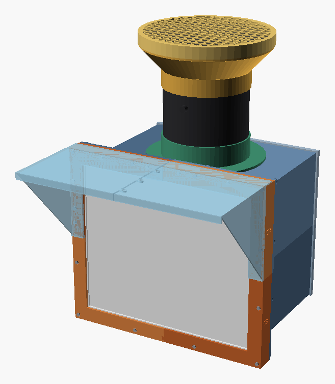
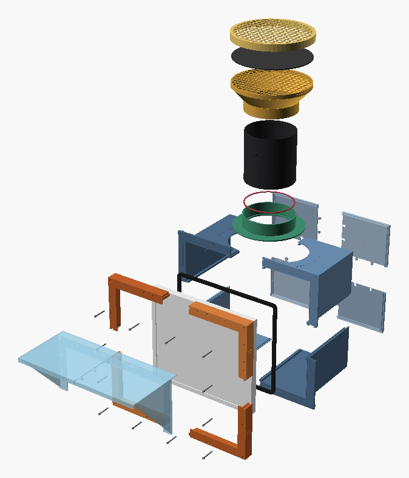
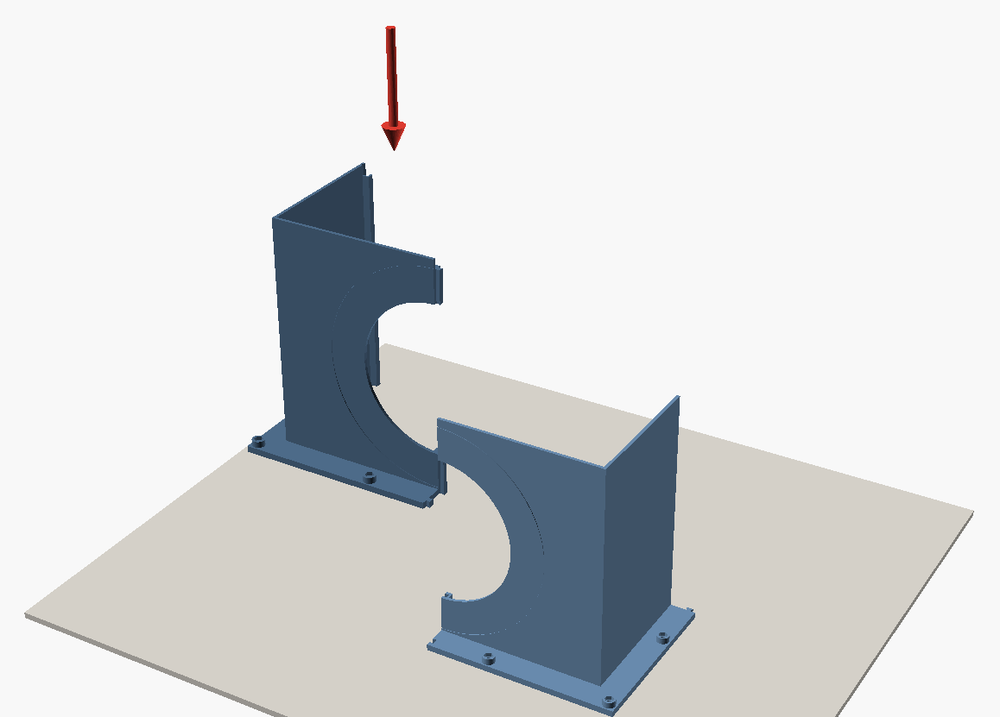
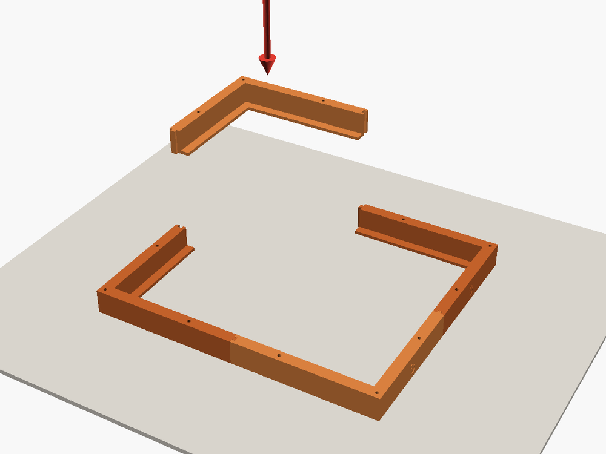

# LFH v1 — 3D-Printed Laminar Flow Hood

**A cheap, fully 3D-printed laminar flow hood for sterile work** (mushroom culture, agar, and similar), in the style of the [Gordotek laminar flow box](https://gordotek.org/laminarflowbox). Designed in OpenSCAD for the Elegoo Centauri Carbon 2 (256 × 256 mm bed), and split into 18 parts that each fit the bed.

<p align="center">
  
  
</p>

## How it works

- A **True HEPA panel** forms the front face.
- A **150 mm inline duct fan** sits on top, intake up and blowing down into a sealed box. That pressurises the box, so clean air leaves through the HEPA as a laminar sheet.
- An **intake bell** on the fan holds a washable aquarium-floss pre-filter disc under a twist-lock grille lid.
- A detachable **clear visor** hangs on magnets over the work zone.

**Pass test:** hold a lighter flame 5–10 cm in front of the filter at 9 points. It should lean about 45° and stay steady. A plug-in speed controller sets the fan speed. Smoke should run straight out with no curl-back and no leak round the clamp.

## Where to start

| You want to… | Open |
|---|---|
| **Build it** | [`Models/Documents/LFH_v1_Build_Manual_v5.pdf`](Models/Documents/LFH_v1_Build_Manual_v5.pdf) |
| **Print it** | the STLs in [`Models/`](Models) (start with `Test/P00_coupons.stl`) |
| **Modify the design** | [`Models/lfh_v1_reference.scad`](Models/lfh_v1_reference.scad) and the [v5 build spec](Models/Documents/LFH-v1_OpenSCAD_build_spec_v5.md) |
| **Understand the decisions** | [`docs/HANDOVER.md`](docs/HANDOVER.md) |

## Design at a glance

- **Size-coded sliding dovetails.** The box is four L-shaped quarters that slide together along Y and are superglued. Top and right seams are one size, bottom and left another, so a wrong swap physically clashes. Every part is numbered and there is one assembly order that works.
- **Clamp frame as compression stop.** 12 × M4 × 40 bolts run into captive nuts. The clamp's rear face stops against the flange, so the EPDM gasket can't be over-squashed.
- **Flat flange face with a guide line.** No gasket groove, because a recess on the bed side prints as a mid-air roof.
- **Bayonet intake lid.** Three lugs: push down, twist clockwise to a stop.
- **Magnet visor.** Hangs by its rear lip on the clamp top. The 8 magnet pairs only stop knocks and carry no load.

<p align="center">
  
  
</p>

## Parts

Every printable part has its own wrapper `.scad` and its own `.stl` in [`Models/`](Models). Printed in PLA unless stated.

| ID | File | Part | Material | Mass |
|---|---|---|---|---|
| P00 | `Test/P00_coupons` | Fit-test coupon plate + socket gauge. **Print first** | PLA | 62 g |
| P00b | `Test/P00b_gauge_G2` | Bell sleeve gauge | PLA | 15 g |
| P01–P04 | `P01_Q1` … `P04_Q4` | Box quarters (integral front flange) | PLA | 259 / 265 / 341 / 340 g |
| P05–P08 | `P05_B1` … `P08_B4` | Back plate quarters (jigsaw tabs, U-channel) | PLA | 63 g each |
| P09–P12 | `P09_C1` … `P12_C4` | Front clamp quarters | PLA | 92 g each |
| P13 | `P13_socket` | Fan socket | PLA | 135 g |
| P14 | `P14_ring_TPU` | Fan gasket ring | TPU 95A | 4 g |
| P15 | `P15_bell` | Intake bell | PLA | 189 g |
| P16 | `P16_lid` | Intake lid (bayonet) | PLA | 96 g |
| P17–P18 | `P17_V1`, `P18_V2` | Visor halves | Clear PLA or clear PETG | 177 / 176 g |

Total about 2.3 kg PLA, plus about 0.35 kg clear PLA/PETG and a few grams of TPU. Parts P01 and P02 print with **Auto supports** (they only land on the crown of the half fan hole). Everything else prints without. Full print settings are in the manual.

## Bought parts

| Item | Spec | Qty |
|---|---|---|
| 150 mm inline duct fan | 500 m³/h or greater. Body Ø148.1, 150 long | 1 |
| Plug-in variable fan speed controller | UK 3-pin | 1 |
| True HEPA filter set for Levoit LV-PUR131 | Frame 339 × 291, 22–25 thick. Only the HEPA panel is used | 1 set |
| Aquarium floss, 1 cm thick | One 50 × 50 cm sheet gives four Ø224 discs | 1 sheet |
| EPDM self-adhesive foam strip | 10 mm wide × 8 mm thick, **solid sponge** | ~1.4 m |
| M4 socket cap bolts | M4 × 40 | 12 |
| M4 hex nuts | 7 mm across flats, 3.2 thick | 12 |
| Disc magnets | Ø6 × 3 mm, N42 or stronger | 16 |
| Plasti Dip | Brush-on, 250 ml tin | 1 |
| Thin cyanoacrylate (superglue) | Water-thin | 1 bottle |
| Neutral-cure silicone | Not acetoxy (vinegar) | 1 small tube |

Product photos and the full manifest with listing names are in the manual.

## Regenerating STLs

Open any wrapper in OpenSCAD (2021.01 or newer) and export:

```
openscad -o P01_Q1.stl Models/P01_Q1.scad
```

Each wrapper is three lines: it includes `lfh_v1_reference.scad`, then sets `part` and `pose`. Keep `Test/` inside `Models/`, since its wrappers use `include <../lfh_v1_reference.scad>`.

## Rebuilding the manual

The manual is generated from [`manual/`](manual): `build_site.py` writes `site/index.html`, then `pdf.js` (Playwright) renders it to PDF. `checks.py` runs the acceptance battery (bed fit, interference, slide paths, wrong-swap clash, bayonet path, visor fit) and needs `trimesh`, `manifold3d` and `numpy`. The scripts were written on Linux, so run them under Git Bash or WSL on Windows.

## Repo layout

```
Models/             reference .scad, P01–P18 wrappers + STLs
  Test/             fit-test coupons and gauge
  Documents/        manual PDFs and build specs (v5 = current)
manual/             manual generator, renders, check scripts
docs/               handover notes, feedback log, archive
```

## Status

- Design is finished and verified at the measured dimensions: bed fit, interference, slide paths, wrong-swap blocking, bayonet and visor all pass.
- Fit tests (P00, P00b) passed on 17 Nov 2026, so no parameter changes were needed.
- **Untested:** clear PETG visor settings, and the optional air spreader (add one only if the bottom row of the flame test leans noticeably harder).
- Manual renders were made from the 31 Oct STLs. Released docs are versioned and never overwritten.

## Licence

[Creative Commons Attribution-NonCommercial 4.0 (CC BY-NC 4.0)](LICENSE). You may copy, modify and share the designs and documents, but you must **credit the author (TheSharmanator, with a link to this repo)** and you may **not use them commercially**. Building one for your own use is fine.

## Credit

Based on the laminar flow box concept by [Gordotek](https://gordotek.org/laminarflowbox).

## Disclaimer

This is a hobby project and is **not** a certified biosafety cabinet. It does not protect you from hazardous organisms. Test it with the flame and smoke checks before relying on it.
